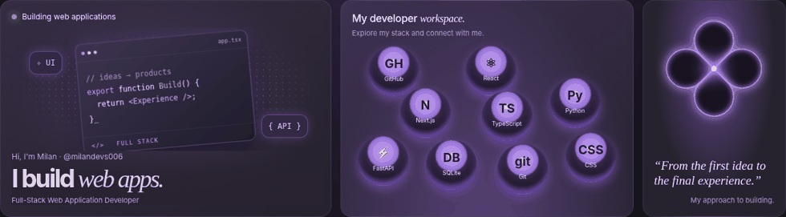

  

  # Hi, I'm Milan 👋

  **Full-Stack Web Application Developer**

  *From the first idea to the final experience.*

  
  

## ✦ Developer workspace

<table>
<tr>
<td width="50%" valign="top">
<h3>◈ Frontend</h3>
Building responsive interfaces and engaging user experiences.  
  
</td>
<td width="50%" valign="top">
<h3>◈ Backend</h3>
Developing application logic, APIs and integrations.  
 
</td>
</tr>
<tr>
<td valign="top">
<h3>◈ Data</h3>
Connecting applications to persistent, structured data.  
 
</td>
<td valign="top">
<h3>◈ Product engineering</h3>
Turning ideas into complete web applications.  
 
</td>
</tr>
</table>

## ✦ Project showcase

| Project | Explore |
| :--- | :--- |
| **CodeWithMilan** — Python repository | [View repository ↗](https://github.com/milandevs006/CodeWithMilan) |
| **More projects** — browse my public work | [All repositories ↗](https://github.com/milandevs006?tab=repositories) |

## ✦ My approach

`IDEA` → `DESIGN` → `DEVELOP` → `TEST` → `REFINE`

I enjoy building across the full stack, bringing interfaces, application logic and data together into useful digital products.

---

  <b>Design. Develop. Build.</b> 
  Always learning · Always creating

