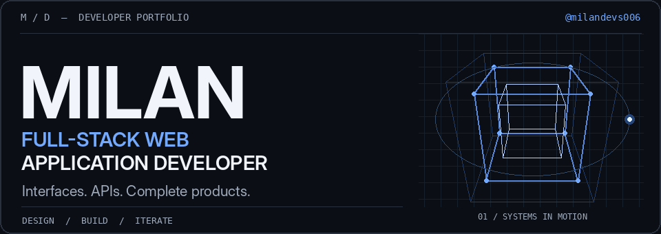
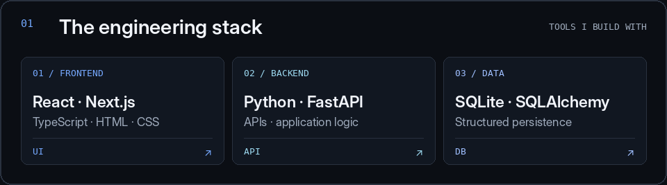
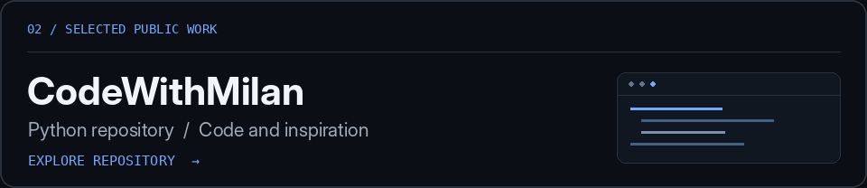
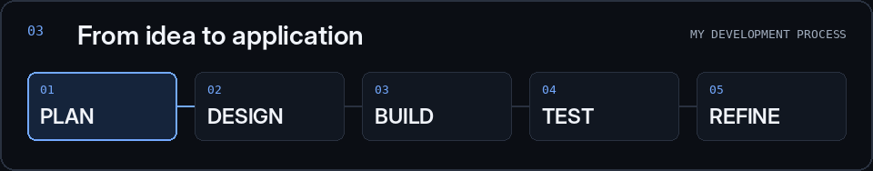
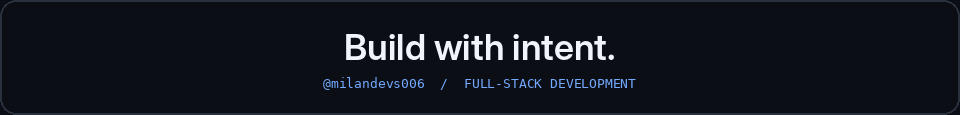

  
  
<b>Full-Stack Web Application Developer</b> · <a href="https://github.com/milandevs006?tab=repositories">Explore my work</a> · <a href="https://github.com/milandevs006">GitHub</a>

## About my work

I build full-stack web applications, connecting responsive interfaces, application logic and persistent data. I enjoy turning ideas into practical digital products and refining them through testing and iteration.

<b>Explore my development toolkit</b>

| Layer | Technologies |
| :--- | :--- |
| Frontend | HTML, CSS, JavaScript, TypeScript, React, Next.js |
| Backend | Python, FastAPI |
| Database | SQLite, SQLAlchemy |
| Development tools | Git, GitHub, VS Code |

## Projects

Public code and experiments. Explore my repositories on GitHub.

[Browse all my public repositories →](https://github.com/milandevs006?tab=repositories)

## How I build

A practical workflow: plan, design, build, test and refine.

| Interface | Application | Data |
| :--- | :--- | :--- |
| Responsive layouts and reusable components | APIs and business logic | Persistence and structured records |

## Development activity

View my real GitHub contributions and repository history.

[Contribution activity](https://github.com/milandevs006#contribution-activity) · [Public repositories](https://github.com/milandevs006?tab=repositories) · [Public stars](https://github.com/milandevs006?tab=stars)

  

